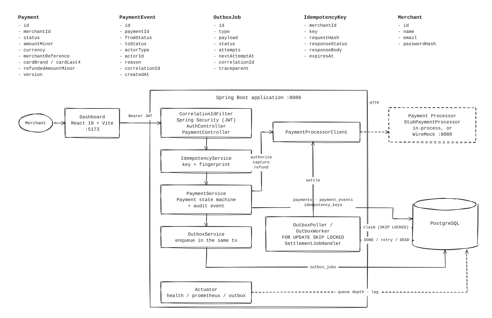
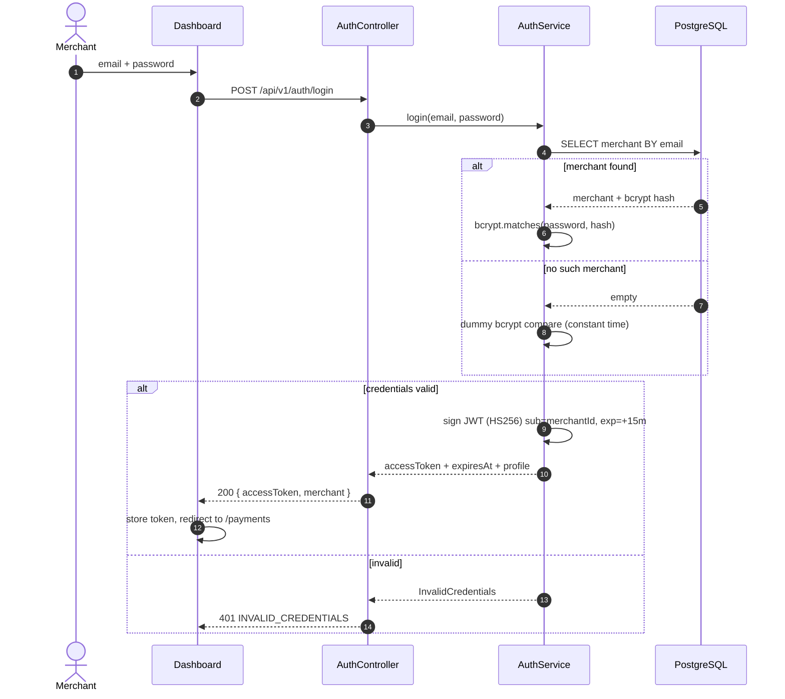
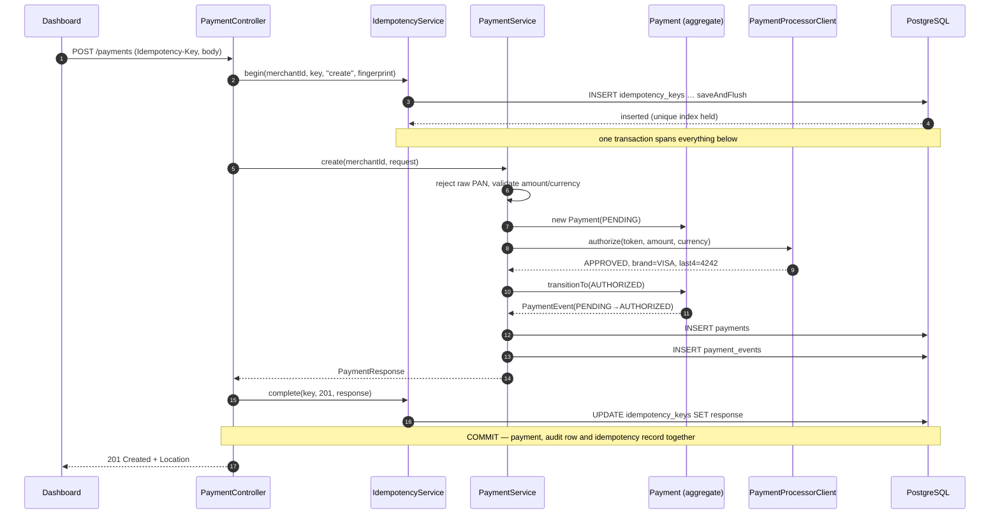
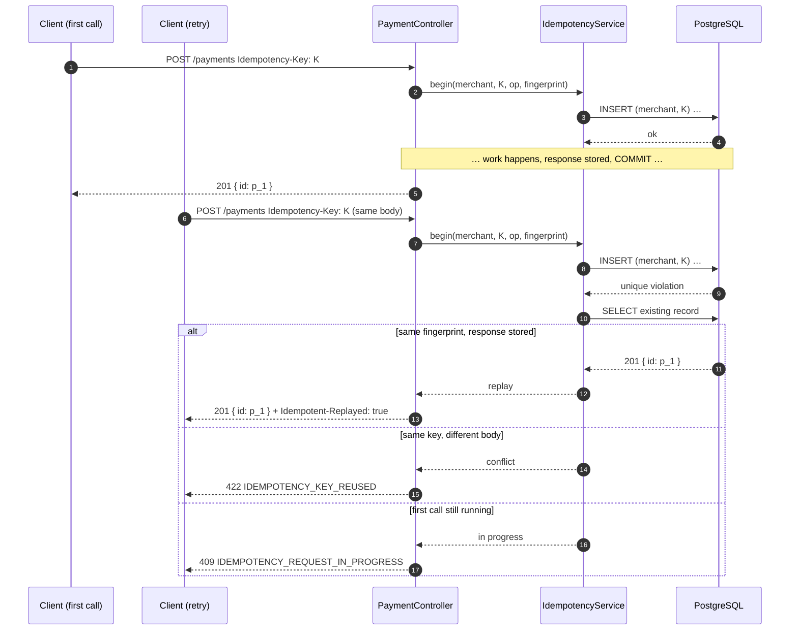
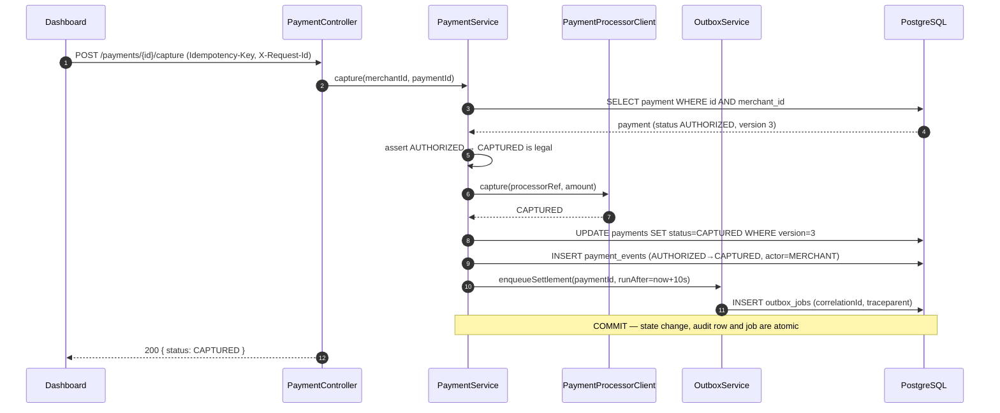
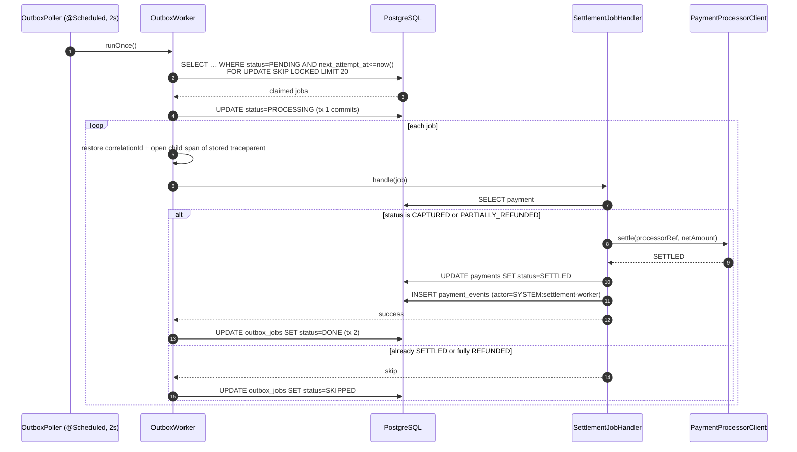
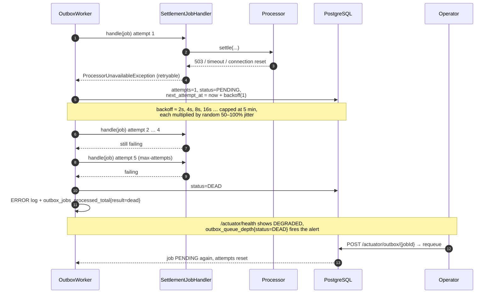
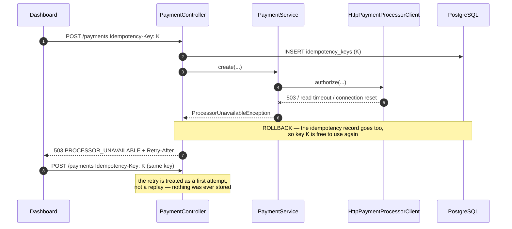
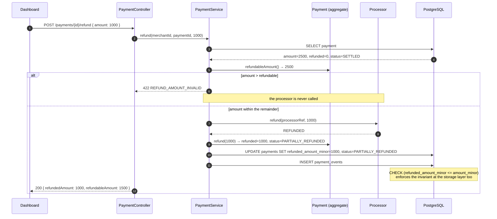
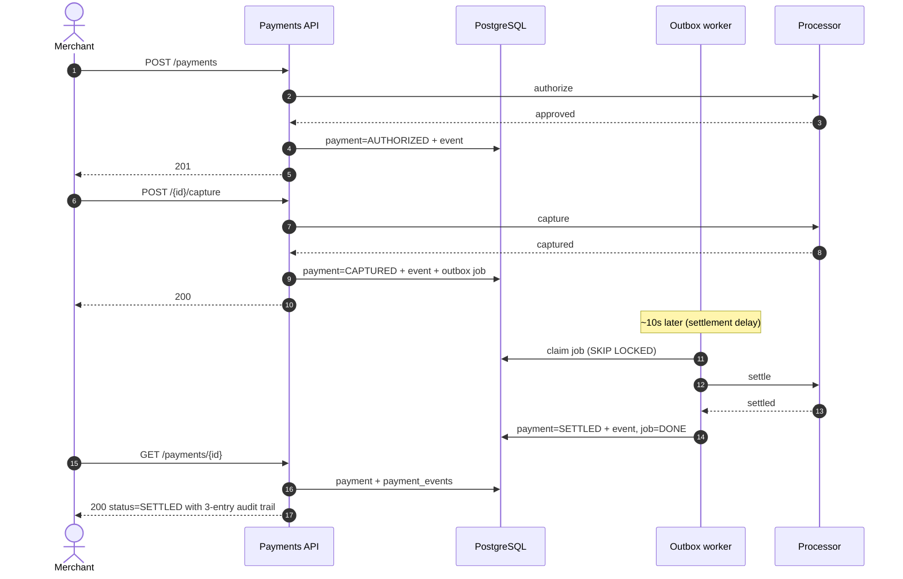

A payment processing platform where a merchant signs in, takes card payments, captures and refunds them, and
watches them settle in the background. It is built as a small slice of a real payments system done properly:
correctness (no double charges), a complete audit trail, and operability were chosen over feature breadth.

| Part | Technology |
|---|---|
| Backend API | Spring Boot 4.1 (Java 21), Spring Security, Spring Data JPA, Flyway |
| Database | PostgreSQL 16+ (with `pg_trgm` for substring search) |
| Dashboard | React 19 + TypeScript + Vite |
| Asynchronous work | Transactional outbox with retries, exponential backoff and dead-lettering |
| Processor | Deterministic in-process stub, or WireMock over HTTP |
| Observability | Structured JSON logs (ECS), Micrometer/Prometheus metrics, Micrometer Tracing (W3C) |

## Quick start (Docker)

All you need is [Docker Desktop](https://www.docker.com/products/docker-desktop/), installed and running.
Nothing is built on your machine: the app runs from images published on
[Docker Hub](https://hub.docker.com/u/mohankrishna27), for Intel/AMD and Apple Silicon alike.

**Step 1 — Get the project.** Clone it, or use **Code → Download ZIP** on this page and unzip it.

```bash
git clone https://github.com/MohanKrishna27062001/Payment-Processing-Platform.git
```

**Step 2 — Move into the project folder**, the one that contains `compose.hub.yaml`.

```bash
cd Payment-Processing-Platform
```

If you downloaded the ZIP, the folder is named `Payment-Processing-Platform-main` instead.

**Step 3 — Start the application.**

```bash
docker compose -f compose.hub.yaml up -d
```

**Step 4 — Open http://localhost:5173** and sign in as `argyle@example.com` / `demo-password`.

The first start takes a minute or two while the images download and the database is set up. To stop it, run
`docker compose -f compose.hub.yaml down` from the same folder.

To build the images from the source code instead of downloading them, run `docker compose up --build` in
Step 3. More options, including the WireMock processor, are in [Setup instructions](#2-setup-instructions).

---

## Contents

1. [What the system does](#1-what-the-system-does)
2. [Setup instructions](#2-setup-instructions)
3. [API](#3-api)
4. [Architectural overview](#4-architectural-overview)
5. [Sequence diagrams](#5-sequence-diagrams)
6. [Resilience, fault tolerance and retries](#6-resilience-fault-tolerance-and-retries)
7. [Observability and operations](#7-observability-and-operations)
8. [Testing strategy](#8-testing-strategy)
9. [Assumptions](#9-assumptions)
10. [Tradeoffs made](#10-tradeoffs-made)
11. [Production considerations](#11-production-considerations)
12. [Areas for future improvement](#12-areas-for-future-improvement)
13. [Project structure](#13-project-structure)

---

## 1. What the system does

Argyle Payments is a card-acquiring API with a merchant-facing dashboard. A merchant authenticates, submits a
payment against a tokenized card, and the platform drives that payment through its lifecycle, recording every
transition as an immutable audit event.

**The money path**

| Step | What happens |
|---|---|
| **Authorize** | `POST /payments` asks the processor to reserve funds on the card. Success → `AUTHORIZED`; a decline → `FAILED` with a reason. Synchronous: the caller learns the outcome in the response. |
| **Capture** | `POST /payments/{id}/capture` tells the processor to take the reserved funds. `AUTHORIZED → CAPTURED`, and a settlement job is enqueued in the same database transaction. |
| **Settle** | A background worker picks up that job after a configurable delay (simulating the processor's batch cut-off) and moves `CAPTURED → SETTLED`. This is the asynchronous workflow. |
| **Refund** | `POST /payments/{id}/refund` returns money, in full or in part. A partial refund leaves the payment `PARTIALLY_REFUNDED` and still settleable for the net amount; refunding the remainder takes it to `REFUNDED`. |

**The lifecycle**

```
PENDING ──► AUTHORIZED ──► CAPTURED ─────────────► SETTLED
   │             │             │                      │
   │             │             └──► PARTIALLY_REFUNDED ◄┘   (repeatable; can still settle the net)
   │             │                          │
   └──► FAILED ◄─┘                          └──► REFUNDED ◄── CAPTURED / SETTLED
```

`FAILED` and `REFUNDED` are terminal. Every legal transition is declared in one place (`PaymentStatus`) and
applied only through `Payment.transitionTo(...)`, which returns the audit event that is persisted alongside the
state change.

**What the dashboard does**

Sign in, create test payments, search and filter the ledger (by status, date range, amount range, payment id or
merchant reference substring), sort by created date / amount / status, page through results, open a payment to
see its full status history, and capture or refund it.

**What it deliberately is not.** There is no sign-up flow, no multi-user merchant, no webhook delivery to
merchants, and no reconciliation against processor reports. The platform never sees a raw card number — see
[Assumptions](#9-assumptions).

---

## 2. Setup instructions

### Prerequisites

**With Docker you need nothing else** — jump to option A. Everything below is for running the pieces
directly on your machine.

| Tool | Version | Notes |
|---|---|---|
| Java | 21+ | Maven is not needed; the project ships the Maven Wrapper (`mvnw`) |
| Node.js | 20+ | For the dashboard |
| PostgreSQL | 16+ | Only for option C; option B starts its own |

### Three ways to run it

| | Needs | Command | Data |
|---|---|---|---|
| **A. Docker** | Docker only | `docker compose up --build` | Kept in a volume |
| **B. Embedded PostgreSQL** | Java + Node | `./mvnw spring-boot:run -Dspring-boot.run.profiles=embedded` | Discarded on exit |
| **C. Local PostgreSQL** | Java + Node + PostgreSQL | Steps 1–3 below | Kept |

#### A. Docker — nothing installed but Docker

```bash
docker compose up --build
```

Open **http://localhost:5173**. That is the whole setup: PostgreSQL, the backend and the dashboard all
build and start together, Flyway applies the six migrations and seeds the demo merchants, and the backend
is not started until the database reports healthy, nor the dashboard until the backend does.

The first build compiles both halves inside Docker, so expect a few minutes and network access for Maven
and npm; later runs reuse the layer cache. `docker compose down -v` removes the database volume and gives
you a clean slate.

| Service | URL |
|---|---|
| Dashboard | http://localhost:5173 |
| API, Swagger UI, actuator | http://localhost:8080 |
| PostgreSQL | `localhost:5433`, user/password/db all `payments` (5433 so it never clashes with a local PostgreSQL on 5432) |

nginx serves the built dashboard and proxies `/api` to the backend, so the browser talks to one origin and
no CORS is involved — the same arrangement the Vite dev server provides.

To exercise the processor over real HTTP instead of the in-process stub:

```bash
PROCESSOR_MODE=http docker compose --profile wiremock up --build
```

On Windows PowerShell: `$env:PROCESSOR_MODE="http"; docker compose --profile wiremock up --build`. The same
works with the published images: add `-f compose.hub.yaml` and drop `--build`.

#### B. Embedded PostgreSQL — nothing installed but Java

```bash
cd backend
./mvnw spring-boot:run -Dspring-boot.run.profiles=embedded   # Windows: .\run-embedded.cmd
```

The application starts its own PostgreSQL, applies all six migrations and seeds the demo merchants. Then
run the dashboard as in Step 3.

This is a **real** PostgreSQL, not an in-memory substitute — the binaries arrive as ordinary Maven
dependencies, so "no install" and "real PostgreSQL" are not in conflict. That matters because the schema
needs `pg_trgm` and `pgcrypto`, a GIN index with `gin_trgm_ops`, `text_pattern_ops`, three partial indexes
and `JSONB`, and the outbox worker claims jobs with `FOR UPDATE SKIP LOCKED`. H2 in PostgreSQL mode
supports none of those, so running on it would mean a second, different schema and a worker that could not
demonstrate the concurrent claiming it was built for.

The data directory is temporary and is **discarded when the process exits**, so every run starts from the
migrations and the seed. On Apple Silicon the bundled macOS build runs under Rosetta — see the dependency
comment in `pom.xml` for the native alternative.

#### C. Local PostgreSQL

### Step 1 — Database

**Option A: local PostgreSQL (no Docker)**

```bash
psql -U postgres -f scripts/create-local-db.sql
```

On Windows use the full path, e.g.
`& "C:\Program Files\PostgreSQL\18\bin\psql.exe" -U postgres -f scripts/create-local-db.sql`.

**Option B: Docker**

```bash
docker compose -f backend/compose.yaml up -d
```

Either way this creates the role `payments` and the database `payments`. Flyway creates every table, index and
the demo merchants when the backend starts; no other SQL needs to be run.

### Step 2 — Backend (port 8080)

```bash
cd backend
./mvnw spring-boot:run           # Windows: .\mvnw.cmd spring-boot:run
```

Ready when `http://localhost:8080/actuator/health` reports `"status":"UP"`.

> **Note:** the backend does **not** hot-reload. Any change under `backend/src/**` or `db/migration/**`
> requires a restart. The dashboard does hot-reload.

### Step 3 — Dashboard (port 5173)

```bash
cd frontend
npm install
npm run dev
```

Open **http://localhost:5173**. Vite proxies `/api` to the backend, so no CORS configuration is needed locally.

### Demo accounts

Seeded by `backend/src/main/resources/db/seed/R__demo_merchants.sql` (local only):

| Merchant | Email | Password |
|---|---|---|
| **Argyle Payments** | `argyle@example.com` | `demo-password` |
| Globex Electronics | `globex@example.com` | `demo-password` |

Two merchants exist so tenant isolation can be demonstrated: neither can see or act on the other's payments.

### Test cards and magic amounts

The processor is deterministic, in the style of Stripe's test cards.

| Input | Result |
|---|---|
| `tok_visa` / `tok_success` | Authorized, VISA •••• 4242 |
| `tok_mastercard` | Authorized, MASTERCARD •••• 4444 |
| `tok_decline` | `FAILED`, reason `insufficient_funds` |
| `tok_processor_error` | `503 PROCESSOR_UNAVAILABLE`; nothing is stored, safe to retry |
| `tok_timeout` | Processor hangs past the read timeout → `503`, safe to retry |
| amount > 1,000,000.00 | `FAILED`, reason `exceeds_limit` |
| amount ending **.13** | Settlement fails twice, then succeeds — demonstrates retry with backoff |
| amount ending **.99** | Settlement always fails — dead-lettered after 5 attempts |
| a raw card number as the token | `400 RAW_CARD_DATA_REJECTED` (PCI guard) |

The `.13` / `.99` rules apply in the default **stub** mode. In `http` mode the WireMock mappings in
`backend/stubs/` decide the outcome; see that folder's README for the full token vocabulary.

### Choosing a processor mode

```bash
# default: in-process stub, no network
PROCESSOR_MODE=stub ./mvnw spring-boot:run

# over HTTP against the WireMock stub (exercises timeouts, 5xx and connection resets for real)
PROCESSOR_MODE=http ./mvnw spring-boot:run
```

### Configuration

Everything has a local default; override with environment variables.

| Variable | Default | Purpose |
|---|---|---|
| `DB_URL`, `DB_USERNAME`, `DB_PASSWORD` | local `payments` DB | Database connection |
| `JWT_SECRET` | dev-only value | HMAC signing key; **must** be set (32+ random bytes) outside local dev |
| `JWT_TTL` | `15m` | Access token lifetime |
| `OPS_USERNAME` / `OPS_PASSWORD` | `ops` / *(empty)* | HTTP Basic for operator actuator endpoints; empty password locks them for everyone |
| `PROCESSOR_MODE` | `stub` | `stub` or `http` |
| `PROCESSOR_URL` | `http://localhost:8089` | Processor base URL in `http` mode |
| `SETTLEMENT_DELAY` | `10s` | Delay after capture before settlement runs |
| `OUTBOX_RETENTION` | `P7D` | `DONE` jobs older than this are purged hourly; `DEAD` jobs are kept |
| `CORS_ALLOWED_ORIGINS` | `http://localhost:*` | Allowed browser origins |
| `MANAGEMENT_PORT` | same as `PORT` | Put actuator on a port that is not publicly exposed |
| `SPRINGDOC_ENABLED` | `true` | OpenAPI schema and Swagger UI |
| `OTLP_METRICS_ENABLED` | `false` | Push metrics to an OpenTelemetry Collector |
| `PORT` | `8080` | HTTP port |

### Running the tests

```bash
cd backend && ./mvnw test        # 69 backend tests across 13 classes (unit + integration)
cd frontend && npm test           # frontend unit tests
cd frontend && npm run typecheck  # TypeScript, no emit
```

Integration tests use **Testcontainers** when Docker is available. Without Docker they fall back to the local
PostgreSQL in an isolated `it_tests` schema, so development data is never touched. If neither is available the
integration tests are skipped and the unit tests still run.

---

## 3. API

Base path `/api/v1`. JSON throughout. Money is an integer in **minor units** (`1050` = 10.50) with an ISO 4217
currency code, so no amount ever passes through a float.

| Method | Path | Purpose | Success |
|---|---|---|---|
| `POST` | `/auth/login` | Email + password → access token | 200 |
| `GET` | `/auth/me` | Current merchant | 200 |
| `POST` | `/payments` | Create and authorize (**Idempotency-Key required**) | 201 + `Location` |
| `GET` | `/payments/{id}` | Payment plus its status history | 200 |
| `POST` | `/payments/{id}/capture` | `AUTHORIZED → CAPTURED`, enqueues settlement (**Idempotency-Key required**) | 200 |
| `POST` | `/payments/{id}/refund` | Full or partial refund (**Idempotency-Key required**) | 200 |
| `GET` | `/payments` | List, search, filter, sort, paginate | 200 |

The OpenAPI schema is served at `/v3/api-docs` (or `.yaml`), with Swagger UI at `/swagger-ui.html`. Note the
port: these are on the backend (8080), not the dashboard (5173) — the Vite proxy only forwards `/api`.

A snapshot is checked in at **[`docs/openapi.yaml`](docs/openapi.yaml)** and
[`docs/openapi.json`](docs/openapi.json), so the API can be read without starting anything.

The running application is authoritative: springdoc derives the schema from the controllers, the DTO records
and their validation annotations, so it cannot drift from the code that enforces the rules. Regenerate the
snapshot rather than hand-editing it, while the backend is up:

```bash
scripts/export-openapi.sh          # Windows: scripts\export-openapi.cmd
```

Re-run it whenever an endpoint or a DTO changes.

### Creating a payment

```http
POST /api/v1/payments
Authorization: Bearer <token>
Idempotency-Key: 7f2a9c1e-…
Content-Type: application/json

{ "amount": 2500, "currency": "USD", "merchantReference": "order-481207",
  "paymentMethod": { "token": "tok_visa" } }
```

### Refunding

```http
POST /api/v1/payments/{id}/refund
Idempotency-Key: 9b3d…

{ "amount": 1000 }      # partial; omit the body entirely to refund everything still refundable
```

A refund larger than the remaining refundable amount is rejected with `422 REFUND_AMOUNT_INVALID`
**before** the processor is called, and the database enforces the same invariant with a check constraint,
so it cannot be violated even by direct SQL.

### Listing and searching

All filters are optional and combinable:

| Parameter | Meaning |
|---|---|
| `status` | Repeatable; any of the seven lifecycle states |
| `from` / `to` | ISO-8601 instants; `to` is exclusive |
| `q` | Exact payment id, or a case-insensitive **substring** of the merchant reference |
| `currency`, `minAmount`, `maxAmount` | Structured filters |
| `sort` | `createdAt`, `amount` or `status`, each `,asc` or `,desc` (default `createdAt,desc`) |
| `page`, `size` | From 0; size 1–100, default 20 |

```
GET /api/v1/payments?status=CAPTURED&status=SETTLED&q=913&sort=amount,desc&page=0&size=10
→ { "items": [...], "page": 0, "size": 10, "totalItems": 42, "totalPages": 5 }
```

`sort` is validated against an allowlist and mapped to entity property names, so no user input ever reaches a
query as an identifier. Every filter is bound as a JPA parameter.

### Errors

Every error uses the same RFC 7807 problem shape, extended with a stable machine-readable `code` and the
request's `correlationId`:

```json
{
  "type": "https://payments.example.com/errors/invalid-state-transition",
  "title": "Invalid state transition",
  "status": 409,
  "detail": "Payment 9f1c… cannot move from SETTLED to CAPTURED.",
  "code": "INVALID_STATE_TRANSITION",
  "correlationId": "my-capture-1"
}
```

| Status | Codes |
|---|---|
| 400 | `VALIDATION_FAILED` (with `errors[]` per field), `IDEMPOTENCY_KEY_REQUIRED`, `INVALID_IDEMPOTENCY_KEY`, `RAW_CARD_DATA_REJECTED`, `INVALID_SORT_FIELD`, `INVALID_SORT_DIRECTION` |
| 401 | `UNAUTHENTICATED`, `INVALID_TOKEN`, `INVALID_CREDENTIALS` |
| 404 | `NOT_FOUND` — also returned for another merchant's payment, so its existence is not leaked |
| 409 | `INVALID_STATE_TRANSITION`, `CONCURRENT_MODIFICATION`, `IDEMPOTENCY_REQUEST_IN_PROGRESS` |
| 422 | `IDEMPOTENCY_KEY_REUSED`, `REFUND_AMOUNT_INVALID`, `PROCESSOR_REJECTED` |
| 503 | `PROCESSOR_UNAVAILABLE` (with `Retry-After`) — retry with the same Idempotency-Key |
| 500 | `INTERNAL_ERROR` — details only in logs, never in the response |

Request values are never echoed back in error messages, so card data and secrets cannot leak through them.

---

## 4. Architectural overview



The domain entities are at the top. Below them, a request flows left to right: dashboard, then the filter chain and controllers, `IdempotencyService`, `PaymentService` (state machine and audit event), and `OutboxService`, all in one database transaction. The outbox worker runs separately, claims due jobs with `SKIP LOCKED` and settles through the same `PaymentProcessorClient`. Actuator reports queue depth and lag.

<details>
<summary>Text version of the diagram</summary>

```
┌──────────────────┐   /api (Vite proxy)   ┌────────────── Spring Boot application ───────────────┐
│ React dashboard  │ ────────────────────► │ CorrelationIdFilter → Security (JWT) → MerchantMdc   │
│ login · list ·   │   Bearer JWT          │        │                                             │
│ filter · sort ·  │   Idempotency-Key     │  Controllers ── IdempotencyService (one transaction) │
│ detail · refund  │   X-Request-Id        │        │                                             │
└──────────────────┘                       │  PaymentService ── Payment (state machine)           │
                                           │        │         └─ audit event (same transaction)   │
                                           │        ├─ PaymentProcessorClient ──► stub | WireMock │
                                           │        ▼                                             │
                                           │  outbox_jobs ◄── OutboxWorker (@Scheduled)           │
                                           │                  SELECT … FOR UPDATE SKIP LOCKED     │
                                           │                  └─ SettlementJobHandler             │
                                           │  Actuator: health · prometheus · outbox              │
                                           └──────────────────────┬───────────────────────────────┘
                                                                  ▼
          PostgreSQL: merchants · payments · payment_events · idempotency_keys · outbox_jobs
```

</details>

| Package | Responsibility |
|---|---|
| `security` | JWT issuing and validation, CORS, operator Basic auth, problem-detail 401/403, merchant id in the log context |
| `auth` | Login and `me` |
| `payment` | Domain model and state machine, use cases, search and sorting, business metrics, the processor boundary |
| `payment.processor` | `PaymentProcessorClient` with two implementations: in-process stub and HTTP client |
| `idempotency` | Safe retries for every money-moving endpoint |
| `outbox` | Generic transactional outbox: claiming, retries, backoff, dead-letter, retention, metrics, health, operator endpoint |
| `settlement` | The settlement job handler |
| `common` | Error format, correlation ID filter and access log, trace propagation, clock |

### Data model

| Table | Purpose |
|---|---|
| `merchants` | Tenant; bcrypt password hash |
| `payments` | Amount, currency, status, card brand + last4, merchant reference, `refunded_amount_minor`, `@Version` |
| `payment_events` | Append-only audit trail: one row per transition with actor, reason, correlation id |
| `idempotency_keys` | `(merchant_id, idempotency_key)` unique, plus the request fingerprint and the stored response |
| `outbox_jobs` | Job type, payload, status, attempts, `next_attempt_at`, correlation id, W3C `traceparent` |

Every payment query leads with `merchant_id`, and so does every index, because tenancy is the first predicate on
every read. Six Flyway migrations (`V1`–`V6`) own the schema; Hibernate is set to `validate` and never alters it.

### Why these boundaries

- **The state machine is the single source of truth about what may happen.** Nothing mutates a status directly.
- **The processor sits behind one interface**, so the stub and a real client are interchangeable, and so the
  failure modes a real network produces are testable offline.
- **The outbox is generic.** Settlement is one `JobType`; merchant webhooks would be a second handler reusing
  the claiming, backoff, dead-lettering, metrics and health that already exist.

---

## 5. Sequence diagrams

### 5.1 Login



The dummy comparison on the "no such merchant" branch is deliberate: without it, response time would reveal
which email addresses exist.

### 5.2 Create payment (authorization) — the happy path



A **decline** differs only in the middle: the processor answers `DECLINED`, the payment transitions
`PENDING → FAILED` with `failureReason`, and the response is still `201` — a decline is a legitimate business
outcome, not a transport error. A **processor outage** is different again: see [5.7](#57-processor-unavailable).

### 5.3 Idempotent replay — the same request sent twice



The fingerprint is a SHA-256 of the operation plus the request body, so reusing a key for a *different* payment
is caught rather than silently returning the wrong result. Because the insert is flushed immediately, two
genuinely concurrent duplicates serialize on the unique index: one proceeds, the other waits and then replays.
An integration test fires eight identical concurrent requests and asserts exactly one payment exists.

### 5.4 Capture and enqueue settlement



`enqueueSettlement` is annotated `Propagation.MANDATORY`: it refuses to run outside a transaction. That turns
"someone later enqueues a job outside the transaction" from a subtle production bug into a startup-time failure.
The consequence is the invariant that matters: **there can never be a captured payment without a settlement job,
nor a job for a capture that rolled back.**

### 5.5 Settlement — the asynchronous workflow



Three short transactions rather than one long one — claim, run, record the outcome — so a hung processor call
never holds a claim open, and a crash between them leaves the job recoverable rather than lost.

The job carries the originating request's `correlationId` and W3C `traceparent`. The worker restores both, so a
log search for one correlation id returns the API request *and* the settlement that happened seconds later on a
different thread, and the two appear as one trace.

### 5.6 Settlement failure — retry, backoff, dead-letter



A **non-retryable** failure short-circuits this: if the handler throws `NonRetryableJobException` — the payment
no longer exists, or the processor rejected the request outright — the job goes straight to `DEAD` without
burning five attempts on something that cannot succeed.

### 5.7 Processor unavailable during authorization



This is the distinction the status codes encode. A **decline** is an answer, so it is stored and returned `201`.
An **outage** is the absence of an answer, so nothing is stored and the caller is told to retry — with the same
key, which is the whole point of having one.

### 5.8 Partial refund



Refunding the remaining 1500 takes the payment to `REFUNDED`. If a settlement job is still pending, it settles
the **net** amount (`refundableAmount()`), which is why `PARTIALLY_REFUNDED → SETTLED` is a legal transition.

### 5.9 End to end — one payment's whole life



---

## 6. Resilience, fault tolerance and retries

Payments fail in ways that cost money when handled badly: a retry that charges twice, a captured payment that
never settles, a worker that dies mid-job. Each is addressed explicitly.

### 6.1 The failure taxonomy

The system classifies every failure into one of three kinds, because each demands a different response.

| Kind | Example | Response |
|---|---|---|
| **A definite answer** | Card declined, limit exceeded | Store it (`FAILED`), return `201`. Retrying will not change it. |
| **No answer** | Timeout, 503, connection reset | Store nothing, return `503` with `Retry-After`. The caller retries with the same key. |
| **A wrong request** | Over-refund, illegal transition, bad sort field | Reject before any side effect: `4xx`, processor never called. |

Getting this wrong in either direction is expensive. Treating a decline as retryable produces a retry storm
against a card that will never approve; treating a timeout as a decline tells a merchant the payment failed when
the funds may in fact have been reserved.

### 6.2 Exactly-once effects: idempotency

Every money-moving endpoint requires an `Idempotency-Key`. The record is written **in the same transaction as
the operation**, which means there is no window where a key exists but the work did not happen, and no stuck
"in progress" rows after a crash — a rollback takes the key with it.

| Scenario | Outcome |
|---|---|
| Same key, same body, after completion | Stored response replayed, `Idempotent-Replayed: true` |
| Same key, different body | `422 IDEMPOTENCY_KEY_REUSED` |
| Same key, concurrently | Second request blocks on the unique index, then replays |
| Same key, after a rolled-back attempt | Treated as a fresh attempt |
| Same key, different merchant | Independent — keys are scoped per merchant |

Keys are retained for 24 hours.

### 6.3 Never losing work: the transactional outbox

The classic failure here is a dual write — update the payment, then publish a message — where a crash between
the two leaves a captured payment that will never settle. The outbox removes the gap by making the job part of
the same commit. `OutboxService.enqueueSettlement` is `Propagation.MANDATORY`, so this cannot be bypassed by
accident.

### 6.4 Retries and backoff

| Concern | Approach |
|---|---|
| Who picks up a job | `SELECT … FOR UPDATE SKIP LOCKED LIMIT 20` — any number of workers, no job processed twice concurrently, no lock contention between them |
| Retry schedule | Exponential: ≈2s, 4s, 8s, 16s, 32s, capped at 5 minutes |
| Thundering herd | Each delay is multiplied by random 50–100% jitter, so a batch failed by one outage does not retry in lockstep |
| Give-up point | 5 attempts, then `DEAD`: ERROR log, `result=dead` metric, visible in `/actuator/health` |
| Fast failure | `NonRetryableJobException` dead-letters immediately rather than burning attempts |
| Recovery | An operator requeues with `POST /actuator/outbox/{jobId}` (Basic auth, operator credentials only) |

### 6.5 Surviving a crashed worker

A worker that dies after claiming a job leaves it `PROCESSING` forever. Jobs stuck in `PROCESSING` for longer
than `stuck-after` (5 minutes) are returned to `PENDING` and retried. If the worker in fact died *after*
settling but *before* recording the job as done, the handler finds the payment already `SETTLED` and completes
the job as `SKIPPED` — the handler is idempotent, so replay is always safe. There is an integration test for
exactly this.

### 6.6 Containing a slow processor

| Guard | Value | Why |
|---|---|---|
| Connect timeout | 1s | A processor that will not accept a connection should fail fast |
| Read timeout | 3s | The processor call happens inside a database transaction, so this is precisely how long one slow response can hold a connection from a pool of 10 |
| Pool connection timeout | 5s | Requests fail fast instead of queueing when the pool is exhausted |
| HTTP/1.1 pinned | — | The JDK client defaults to HTTP/2 and attempts an h2c upgrade some servers refuse with `RST_STREAM` |

These numbers are related, not arbitrary: pool size ÷ read timeout bounds how badly a degraded processor can
affect unrelated requests. A circuit breaker is the next step — see
[Production considerations](#11-production-considerations).

### 6.7 Concurrency on a single payment

Capture, refund and settlement load the payment with `SELECT … FOR UPDATE` **before** calling the processor.
Optimistic locking alone is not enough here: `@Version` detects a conflict only at commit, after both requests
have already called the processor, and a rollback cannot take back a refund the processor has paid out. Two
refunds racing on version 3 would both return money to the card while the database recorded one.

With the row lock, a second request for the same payment waits for the first to commit, then validates against
the new state: a second full refund sees `REFUNDED` and gets `409` without calling out, a partial refund sees
the reduced refundable amount, and a refund arriving mid-settlement refunds a `SETTLED` payment instead of
racing the worker. Requests for different payments never wait on each other. `@Version` stays as a backstop for
any write path that does not take the lock.

`ProcessorConcurrencyIntegrationTest` slows the processor down so requests genuinely overlap, then counts
**processor calls**, not rows: two concurrent captures or full refunds call the processor once; two partial
refunds that fit both succeed in turn; and a refund racing settlement never leaves a settlement the processor
made but the audit trail does not show.

### 6.8 Graceful degradation and shutdown

- **Shutdown** is graceful on both sides: in-flight HTTP requests finish, and the scheduler waits up to 20
  seconds for an in-flight outbox batch.
- **Readiness** includes the database, so an instance that cannot reach PostgreSQL is pulled from the load
  balancer rather than serving errors.
- **Liveness** checks nothing external, so a database blip restarts no processes.
- **Outbox health is reported but deliberately excluded from readiness**: a settlement backlog is an operational
  problem to alert on, not a reason to stop serving API traffic that is working perfectly well.
- **`DONE` jobs are purged hourly** after 7 days; `DEAD` jobs are kept, because they are evidence.

---

## 7. Observability and operations

### Logs

Structured JSON (Elastic Common Schema) on stdout. Every line carries `correlationId` (from `X-Request-Id` or
generated, and echoed back in the response), `traceId`/`spanId`, and where known `merchantId`, `paymentId` and
`jobId`.

**Levels:** `INFO` for state changes, logins and the access log; `WARN` for retries, failed logins and rejected
optimistic locks; `ERROR` for dead-lettered jobs and unhandled exceptions; `DEBUG` for processor calls.

**Sensitive data:** raw card numbers are rejected at the API and never stored or logged — only brand and last4.
Request bodies, passwords and `Authorization` headers are never logged; DTOs holding secrets override
`toString()`. A failed login logs a reason, not the email address.

### Metrics (`/actuator/prometheus`)

| Signal | Metric |
|---|---|
| Rate, errors, duration | `http_server_requests_seconds{uri,method,status,outcome}` with histograms for p95/p99 |
| Business | `payments_transitions_total{from,to}`, `payments_current{status}` |
| Auth | `auth_logins_total{result}` |
| Queue depth | `outbox_queue_depth{status=PENDING\|PROCESSING\|DEAD}` |
| Processing lag | `outbox_lag_seconds` — age of the oldest due job not yet processed |
| Retries and failures | `outbox_jobs_processed_total{type,result=success\|skipped\|retry\|dead}` |
| Async latency | `outbox_job_duration_seconds`, `outbox_job_end_to_end_seconds` |

Gauges refresh on a schedule, so a Prometheus scrape never queries the database. Suggested alerts:
`outbox_queue_depth{status="DEAD"} > 0`, `outbox_lag_seconds > 120`, 5xx ratio > 1%, p99 > 500 ms.

### Tracing

Micrometer Tracing (Brave bridge, W3C propagation) creates a span per request. When a job is enqueued the
current `traceparent` is stored on the outbox row; the worker opens a **child span of that context**, so an API
request and the settlement that follows it seconds later form a single trace. Sampling is 100% locally and
around 10% in production.

### Health and operator endpoints

| Endpoint | Use |
|---|---|
| `/actuator/health/liveness` | Restart the process if this fails |
| `/actuator/health/readiness` | Remove from the load balancer if this fails (includes the database) |
| `/actuator/health` | Full view including `outbox` (pending / processing / dead / lag) |
| `/actuator/outbox` | **Operator only.** Lists dead letters; `POST /{jobId}` requeues one |
| `/actuator/prometheus`, `/actuator/metrics` | Scrape and inspect |

Operator endpoints sit behind HTTP Basic with credentials separate from merchant tokens; a merchant JWT is never
accepted there. With no `OPS_PASSWORD` set they are locked for everyone.

### Audit trail

`payment_events` is append-only: one row per transition with `from_status`, `to_status`, `actor_type`
(`MERCHANT` or `SYSTEM`), `actor_id`, `reason`, `correlation_id` and timestamp, written in the same transaction
as the change. It is returned by `GET /payments/{id}` and rendered as the dashboard's status history.

---

## 8. Testing strategy

Tests concentrate where a bug costs money or trust.

| Layer | What | Why |
|---|---|---|
| Unit | All status pairs of the state machine | The core invariant; any change must be deliberate |
| Unit | `Payment` transitions, partial-refund arithmetic, `OutboxJob` retry/dead-letter, `BackoffPolicy`, stub processor, JWT issue/expiry/forgery, short-secret rejection | Pure logic, fast |
| Integration | Login, 401s, expired and tampered tokens, actuator security, health probes | Security is configuration-heavy; only an end-to-end test proves it |
| Integration | Create, decline, processor outage, raw PAN, validation, capture, refund, invalid transitions, search, sorting, pagination | Real SQL, real constraints, real serialization |
| Integration | **Tenant isolation** — another merchant gets 404 and cannot capture | Data-leak prevention |
| Integration | **Idempotency** — replay, key reuse → 422, per-merchant scope, 8 concurrent identical requests → 1 payment, 2 concurrent captures → one 200 and one 409 | Proves "no double charge" under races, not merely in sequence |
| Integration | **Settlement** — success with the correlation id carried across, retry until success, dead-letter, refund-before-settle skip, crashed-worker recovery | The async failure paths are the ones that break in production |
| Integration | **Partial refunds** — instalments cannot exceed the original, retrying an instalment replays rather than refunding twice | The invariant that protects the merchant's money |
| Integration | **SQL injection** — 7 payloads across every filter; a payload stored as a reference comes back verbatim | Proves parameterization rather than asserting it |
| Frontend | Money parsing and formatting, amount validation across letters, symbols, separators and multiple decimal points | The UI logic that touches amounts |

Tests drive the worker directly instead of waiting for the scheduler, so they are deterministic. Deliberately
not covered: UI component tests and browser end-to-end tests — see
[future improvements](#12-areas-for-future-improvement).

---

## 9. Assumptions

Where the brief was open to interpretation, these are the calls that were made.

| Area | Assumption |
|---|---|
| **Money** | Integers in minor units, one currency per payment, maximum 1,000,000.00 per payment. No currency conversion. |
| **Card data** | The client never sends a raw PAN. Tokenization happens at the processor (a hosted field or SDK), and the platform stores only a token reference, brand and last4. A request containing something that looks like a card number is rejected outright. This keeps PCI DSS scope minimal. |
| **Authorization** | Synchronous at creation, so `PENDING` is transient. A decline is a business outcome stored as `FAILED` with HTTP 201; an outage is a transport error with HTTP 503 and nothing stored. |
| **Capture** | Full capture only. Partial capture is not supported; partial **refund** is. |
| **Settlement** | Triggered per payment after a configurable delay, standing in for the processor's batch cut-off. Chosen as the asynchronous workflow because it is the only path to `SETTLED` in the lifecycle and needs no fabricated external system — webhooks would need a fake receiver and reconciliation a fake bank report. |
| **Refunds** | Multiple partial refunds are allowed up to the original amount. A payment with outstanding refunds can still settle, for the net. Refunds are not themselves first-class entities with their own ids — see future improvements. |
| **Merchants** | Provisioned out of band (seeded); no sign-up flow, one user per merchant. |
| **Idempotency** | Keys are client-generated, scoped per merchant, and retained 24 hours. |
| **Search** | Payment id lookup or merchant-reference substring, plus structured filters. Not full-text search. |
| **Merchant reference** | Merchant-supplied and deliberately **not** unique: one order can legitimately have several payments (a retry after a decline, a deposit then the balance). Duplicate *charges* are prevented by the idempotency key, which is a different question. |
| **Time** | All timestamps are UTC instants; the dashboard renders in the viewer's locale. |

---

## 10. Tradeoffs made

| Chose | Instead of | Gained | Gave up / when to revisit |
|---|---|---|---|
| PostgreSQL outbox table with a polling worker | Kafka or RabbitMQ | No extra infrastructure; the job and the state change commit atomically | Broker throughput and fan-out, plus up to ~2s polling latency. At volume, stream the outbox to Kafka via CDC (Debezium) |
| Stateless JWT (HS256), 15 minutes, no refresh token | Server sessions or refresh tokens | Horizontal scaling, trivial validation | Cannot revoke before expiry; re-login every 15 minutes. Add refresh tokens with a deny-list, or RS256 with key rotation |
| Idempotency record in the same transaction as the work | A separate "in progress" record committed first | Crash-safe with no stuck keys; concurrent duplicates serialize on the unique index | A long operation holds its transaction and that row lock open |
| Processor call inside the database transaction | Call outside, then persist | Simple, consistent rollback | A connection is held during an external call. Acceptable with a 3s read timeout; otherwise split into two steps and rely on processor idempotency |
| One deployable (API + worker) | Separate services | Easy to run and reason about | Cannot scale API and worker independently, though `app.outbox.worker.enabled=false` already allows API-only instances |
| Settlement only | Settlement + webhooks + reconciliation | Depth: retries, dead-letter queue, metrics, tracing, tests | Breadth. Webhooks are the next handler on the same outbox |
| Offset pagination | Keyset / cursor | Page numbers in the UI, simple | Slower on deep pages, and rows can shift between pages. Switch to cursors at scale |
| Trigram GIN index for substring search | Prefix-only `LIKE 'x%'` | Searching `913` finds `order-913447`, which is what users expect | A larger index and slower writes. Measured at 1.4ms vs 42.5ms on 200k rows, so worth it |
| Token in `sessionStorage` | httpOnly cookie | No CSRF handling, simple | Readable by injected scripts (XSS). Mitigate with CSP, or move to an httpOnly cookie plus a CSRF token |
| Row lock (`FOR UPDATE`) before any processor call, `@Version` as backstop | Optimistic locking only | The processor is never called twice for the same payment; concurrent partial refunds serialize instead of failing | A second request for the *same* payment waits up to the first one's processor call (bounded by the 3 s read timeout) |
| Deterministic stub processor, with an optional WireMock HTTP mode | A real sandbox such as Stripe test mode | Offline, repeatable, every failure path testable — including timeouts and connection resets | Real network behaviour at scale is not exercised; a real client goes behind the same interface |
| Flyway migrations with Hibernate set to `validate` | `ddl-auto: update` | The schema is reviewable, versioned and identical everywhere | Every change needs a migration file, including during development |

---

## 11. Production considerations

What would change before this carried real money.

- **Secrets.** `JWT_SECRET`, database credentials and `OPS_PASSWORD` from a secret manager (Vault, AWS Secrets
  Manager), never from defaults. Prefer RS256 with a JWKS endpoint and key rotation over a shared HMAC secret.
- **Seed data.** Remove `classpath:db/seed` from `spring.flyway.locations`; provision merchants through an admin
  flow. Disable Swagger UI (`SPRINGDOC_ENABLED=false`) on public ports.
- **Network.** TLS everywhere. Actuator on a separate management port that is not internet-facing
  (`MANAGEMENT_PORT`), with `show-details: when-authorized`.
- **Abuse protection.** Rate limiting and lockout on login, request size limits, a WAF.
- **Real processor client.** Timeouts (already in place) plus a **circuit breaker** (Resilience4j) so a sustained
  outage fails fast instead of consuming the connection pool, bulkheads per downstream, the processor's own
  idempotency keys on every call, and webhooks from the processor for asynchronous outcomes.
- **Observability stack.** OTLP exporter → OpenTelemetry Collector → Tempo or Jaeger; Prometheus and Grafana with
  the alerts above; logs to Loki or ELK with retention policies. Operator tooling for bulk dead-letter replay.
- **Database.** Managed PostgreSQL with HA and point-in-time backups; pool sized against replica count;
  time-partitioning for `payment_events` and `outbox_jobs`; a read replica for search. Migrations applied
  expand/contract so deploys stay zero-downtime.
- **Deployment.** Container images, Kubernetes using the liveness and readiness probes above, the worker as a
  separate deployment so it scales independently, and a rollout strategy that tolerates two versions at once.
- **Compliance.** PCI DSS scope kept minimal by never touching a PAN; audit-trail retention; operator access
  logging; data retention and GDPR policy for merchant data.
- **Frontend.** Built as static assets behind a CDN with a strict Content Security Policy; the accent webfont
  self-hosted rather than fetched from a third party.

---

## 12. Areas for future improvement

- **Refunds as first-class entities** — a `refunds` table with its own ids, statuses and processor references,
  instead of a running total on the payment. Voids of authorizations, and authorization expiry.
- **Merchant webhooks** as a second outbox job type: signed payloads, retries on the existing machinery, and a
  delivery log the merchant can inspect.
- **Reconciliation** against processor settlement reports, with a report of unmatched payments.
- **Auth** — refresh tokens, multiple users per merchant with roles, and API keys for server-to-server use.
- **Search and scale** — cursor pagination, CSV export, saved filters, and a read replica once search traffic
  justifies one.
- **Dashboard** — component tests (React Testing Library) and browser end-to-end tests (Playwright); live
  updates over SSE instead of polling; bulk actions.
- **Operations** — a Grafana dashboard checked into the repository, a dead-letter replay UI, and load tests that
  establish what the outbox throughput actually is.
- **Delivery** — CI that runs the suite with Testcontainers on every push and publishes the multi-architecture
  images on each release; today they are built and pushed by hand.

---

## 13. Project structure

```
compose.yaml                         the whole stack: database, backend, dashboard
backend/                             Spring Boot backend
  Dockerfile                         multi-stage: Maven build, then a JRE-only runtime
  src/main/java/com/mohan/payments/
    auth/            login + me
    security/        JWT, Spring Security, operator Basic auth, problem-detail 401/403, merchant MDC
    payment/         PaymentService, search, sorting, metrics
      domain/        Payment (state machine), PaymentStatus, PaymentEvent (audit), repositories
      api/           PaymentController + DTOs
      processor/     PaymentProcessorClient: StubPaymentProcessor | HttpPaymentProcessorClient
    idempotency/     IdempotencyService + record
    outbox/          generic outbox: job, worker, poller, backoff, retention, metrics, health, endpoint
    settlement/      SettlementJobHandler
    common/          error handling, correlation id filter, tracing support, config
  src/main/resources/
    db/migration/    Flyway schema V1–V6
    db/seed/         demo merchants (local only)
  src/test/          unit + integration tests
  stubs/             WireMock mappings for PROCESSOR_MODE=http
frontend/                            React dashboard (Vite + TypeScript)
  Dockerfile                         multi-stage: npm build, then nginx
  nginx.conf                         serves the bundle and proxies /api to the backend
scripts/create-local-db.sql          one-time database setup without Docker
scripts/export-openapi.*             writes docs/openapi.yaml from the running backend
docs/DESIGN.md                       requirements, data model, deep dives
docs/OBSERVABILITY.md                requirement → evidence mapping, alert thresholds
```
